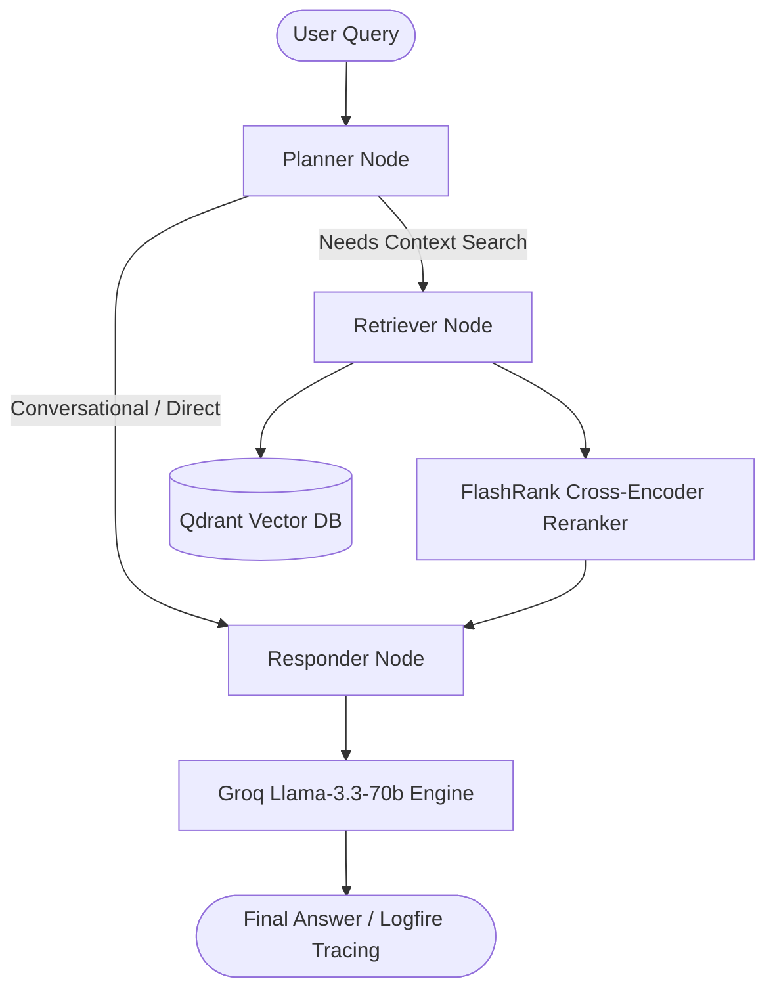

# Enterprise Agentic RAG Pipeline

## Graph-RAG showcase

Launch the read-only repository-intelligence demo with:

```bash
.venv/bin/uvicorn app.showcase_api:app --reload
```

Then open `http://127.0.0.1:8000`. The UI lists ingested repositories, renders a bounded evidence subgraph, and asks grounded questions through the existing Graph-RAG answer generator. It does not expose Cypher execution, database credentials, or ingestion endpoints.

An enterprise-grade, agentic Retrieval-Augmented Generation (RAG) system built with **FastAPI**, **LangGraph**, **Gemini Embeddings**, **Groq (Llama 3.3 70B)**, **Qdrant Vector Database**, **FlashRank Reranker**, and **Logfire Observability**.

---

## 🏗 System Architecture & Workflow



---

## ✨ Features

- **Agentic Workflow (LangGraph)**: Multi-step execution graph supporting planning, state-aware routing, retrieval, and response synthesis.
- **Multi-Format Ingestion**: Supports parsing for **PDF**, **HTML**, **TXT**, **DOCX**, and **PPTX** documents.
- **Dense Vector Search**: Powered by Google Gemini Embeddings (`text-embedding-004`) stored inside **Qdrant Cloud/Local**.
- **Two-Stage Retrieval & Reranking**: Ultra-fast vector retrieval followed by cross-encoder re-ranking using **FlashRank**.
- **LLM Gateway Integration**: Unified routing with fallback handling powered by **Portkey** and **Groq (Llama 3.3 70B)**.
- **Production Observability & Guardrails**: Full execution tracing via **Pydantic Logfire** & input/output validation via **NVIDIA NeMo Guardrails**.

---

## 📂 Project Structure

```text
├── app/
│   ├── agent/             # LangGraph state machine, planner, retriever, responder nodes
│   │   ├── nodes/         # Individual graph nodes (planner.py, retriever.py, responder.py)
│   │   ├── graph.py       # LangGraph DAG workflow definition
│   │   └── state.py       # Agent state schema
│   ├── gateway/           # LLM Gateway client (Portkey / Groq routing)
│   ├── ingestion/         # Document parsing, chunking, and Qdrant vector indexing
│   │   ├── chunking/      # Text splitters and chunking strategies
│   │   ├── loaders/       # Custom parsers (PDF, HTML, Office, Text)
│   │   └── processor.py   # Full ingestion pipeline processor
│   ├── services/          # Core backend services
│   │   └── retrieval/     # Embedding service, Qdrant client, FlashRank reranking
│   └── config.py          # Centralized configuration & environment settings
├── DATA/                  # Local directory for input raw documents
├── processed_data/        # Processed chunk metadata outputs
├── requirements.txt       # Python dependencies
├── index.html             # Basic frontend interface for document upload
└── README.md              # Project documentation
```

---

## 🚀 Getting Started

### 1. Prerequisites

- Python `3.10` or higher
- A [Qdrant Cloud](https://qdrant.tech/) account (or local Qdrant instance)
- API Keys for **Google Gemini**, **Groq**, and **Qdrant**

### 2. Installation

Clone the repository and set up a virtual environment:

```bash
# Create virtual environment
python3 -m venv .venv
source .venv/bin/activate

# Install dependencies
pip install -r requirements.txt
```


### 3. Environment Configuration

Create a `.env` file in the project root directory:

```ini
# Gemini API Key (for embeddings)
GEMINI_API_KEY=your_gemini_api_key

# Qdrant Vector Database
QDRANT_CLUSTER_ENDPOINT=https://your-qdrant-cluster.cloud.qdrant.io
QDRANT_API_KEY=your_qdrant_api_key

# Groq LLM
GROQ_API_KEY=your_groq_api_key
GROQ_FALLBACK_API_KEY=your_groq_fallback_api_key

# Portkey Gateway (optional). Leave both unset to call Groq directly.
# PORTKEY_CONFIG_ID must reference a Portkey configuration that defines the
# GROQ_SLUG provider/virtual-key alias; GROQ_API_KEY alone does not do that.
# PORTKEY_API_KEY=your_portkey_api_key
# PORTKEY_CONFIG_ID=pc-xxx
# GROQ_SLUG=your_portkey_groq_alias

# Neo4j Property Graph Database (Graph-RAG System)
NEO4J_URI=bolt://localhost:7687
NEO4J_USERNAME=neo4j
NEO4J_PASSWORD=your_neo4j_password
NEO4J_DATABASE=neo4j
NEO4J_CONNECTION_TIMEOUT=30.0
NEO4J_MAX_CONNECTION_LIFETIME=3600.0
NEO4J_MAX_CONNECTION_POOL_SIZE=50

# Observability (Optional)
LOGFIRE_TOKEN=your_logfire_token
```

---

## 🛠 Usage

### Ingesting Documents

To process, chunk, embed, and index documents into Qdrant, place your files inside the `DATA/` directory or trigger the ingestion processor:

```python
from app.ingestion.processor import process_file

process_file(
    file_path="DATA/sample_document.pdf",
    filename="sample_document.pdf",
    source_type="pdf"
)
```


### Executing the RAG Agent

You can invoke the compiled agentic graph in Python:

```python
from app.agent.graph import rag_agent

config = {"configurable": {"thread_id": "session-1"}}

response = rag_agent.invoke(
    {"messages": [("user", "What are the key findings in the Q3 financial report?")]},
    config=config
)

print(response["messages"][-1].content)
```

---

## 🕸️ Neo4j Property Graph Storage (Graph-RAG System)

The system includes a dedicated property graph storage engine for multi-hop relationship retrieval across services, code AST, policies, and documents.

### 1. Starting Neo4j Locally (Docker)

You can launch a local Neo4j instance with Docker:

```bash
docker run -d \
  --name neo4j-rag \
  -p 7474:7474 -p 7687:7687 \
  -e NEO4J_AUTH=neo4j/your_secure_password \
  -e NEO4J_PLUGINS='["apoc"]' \
  neo4j:5.26-community
```

Then add your credentials to `.env`:
```ini
NEO4J_URI=bolt://localhost:7687
NEO4J_USERNAME=neo4j
NEO4J_PASSWORD=your_secure_password
NEO4J_DATABASE=neo4j
```

### 2. Initializing the Graph Schema

The schema initialization is idempotent (`IF NOT EXISTS`) and sets up all 17 uniqueness constraints, symbol lookup indexes, and full-text indexes:

```bash
python -m app.graph.schema_init
```

### 3. Checking Database Health

Verify active connectivity, latency, and database version:

```python
from app.graph.connection import db_manager

health = db_manager.health_check()
print(health)
# Output: {'status': 'HEALTHY', 'uri': 'bolt://localhost:7687', 'database': 'neo4j', 'version': '5.26.0', 'edition': 'community', 'latency_ms': 4.12}
```

### 4. Running Graph Storage Tests

Run the comprehensive unit test suite:

```bash
pytest tests/test_graph_storage.py -v
```

To run integration tests against a running Neo4j instance:

```bash
pytest tests/test_graph_integration.py -v
```

### 5. Troubleshooting Connection Failures

- **`ServiceUnavailable: [Errno 111] Connection refused`**: The Neo4j service is not running or port `7687` is blocked. Verify container status with `docker ps` and check if Neo4j is listening on `7687`.
- **`AuthError: The client is unauthorized due to authentication failure`**: Check `NEO4J_USERNAME` and `NEO4J_PASSWORD` in your `.env` file.
- **`ValueError: Neo4j password is not configured`**: Ensure `NEO4J_PASSWORD` is exported in the environment or defined in `.env`.

---

## 💻 Source Code Analysis & Repository Ingestion (Phase 03)

The code ingestion pipeline statically analyzes Python repositories using the built-in `ast` parser, extracting Files, Classes, Functions, APIs, Tests, Imports, and Calls into the property graph.

### Ingesting a Repository

Run the ingestion CLI on any local repository path:

```bash
# Ingest and write directly to Neo4j
python -m app.graph.ingestion.code.pipeline .

# Dry-run extraction preview without writing to Neo4j
python -m app.graph.ingestion.code.pipeline . --no-db
```

Programmatic usage:

```python
from app.graph.ingestion.code.pipeline import ingest_repository

summary = ingest_repository(
    repo_path=".",
    repo_name="my-project",
    org="acme",
    write_to_db=True,
)
print(summary.to_dict())
```

---

## 📄 Document, Architecture & Policy Ingestion (Phase 04)

The document ingestion pipeline processes multi-format organizational documents (`.pdf`, `.docx`, `.pptx`, `.html`, `.md`, `.txt`) and extracts `Document`, `ArchitectureComponent`, `Policy`, and `SecurityRule` entities with explicit source quotes, section references, and cross-domain links to code.

### Ingesting Documents

Run the document ingestion CLI on any directory of documents:

```bash
# Ingest and write directly to Neo4j
python -m app.graph.ingestion.docs.pipeline DATA/true_data

# Dry-run extraction preview without writing to Neo4j
python -m app.graph.ingestion.docs.pipeline DATA/true_data --no-db
```

Programmatic usage:

```python
from app.graph.ingestion.docs.pipeline import ingest_documents

summary = ingest_documents(
    docs_path="DATA/true_data",
    project_urn="urn:project:local:default",
    company_urn="urn:company:acme",
    write_to_db=True,
)
print(summary.to_dict())
```

### Running the Full Test Suite

```bash
pytest tests/ -v
```

---

## 🧪 Evaluation & Tracing

- **LangChain / LangSmith / Logfire**: Automated tracing and observability are integrated into the execution flow.
- **RAGAS & DeepEval**: Evaluates context recall, precision, and response faithfulness using standard evaluation frameworks.

---

## 📄 License

This project is licensed under the MIT License.
